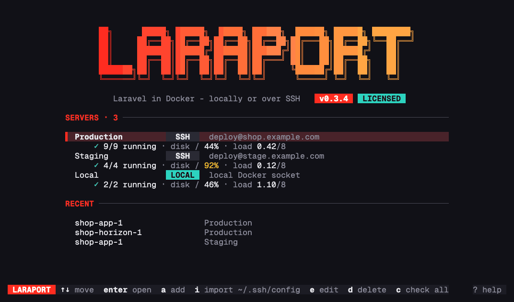
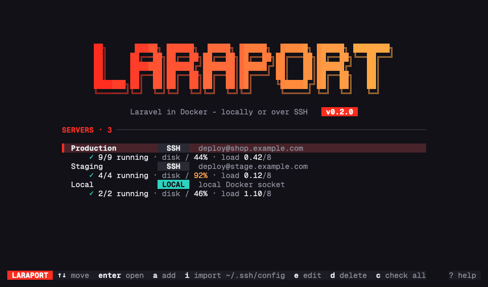
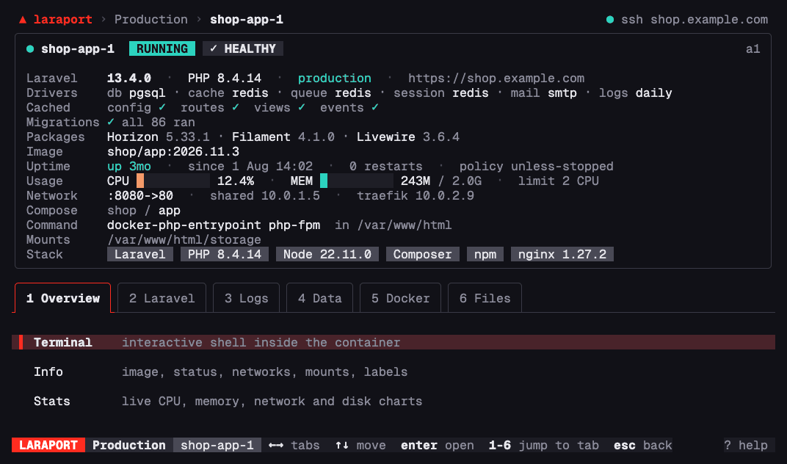
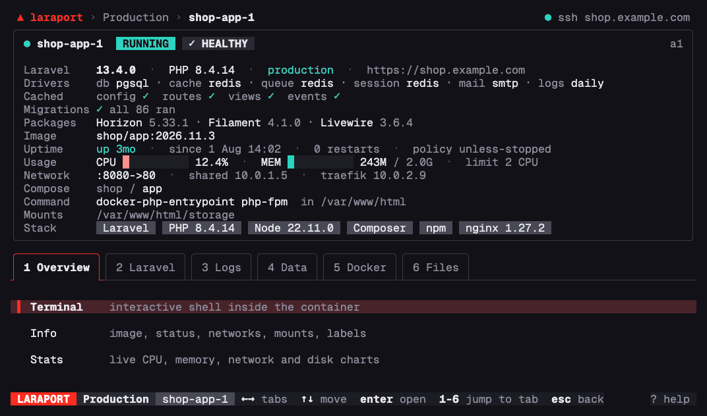
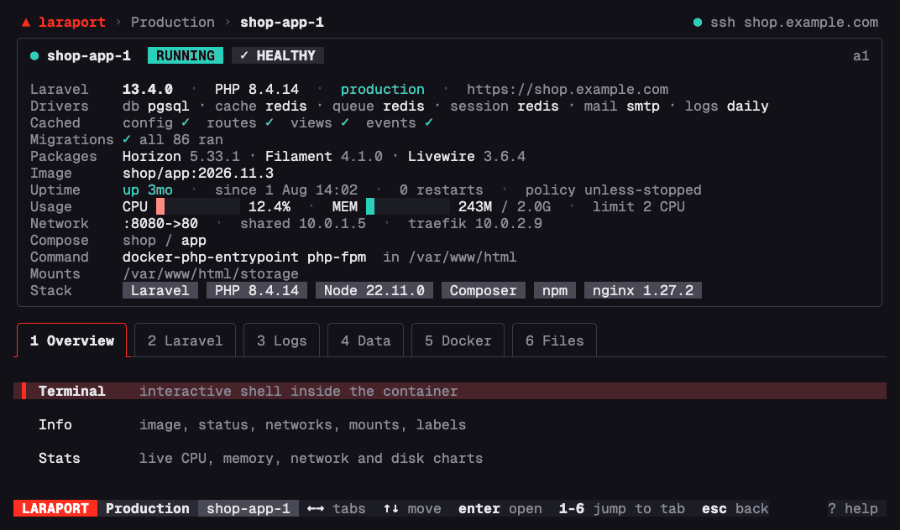
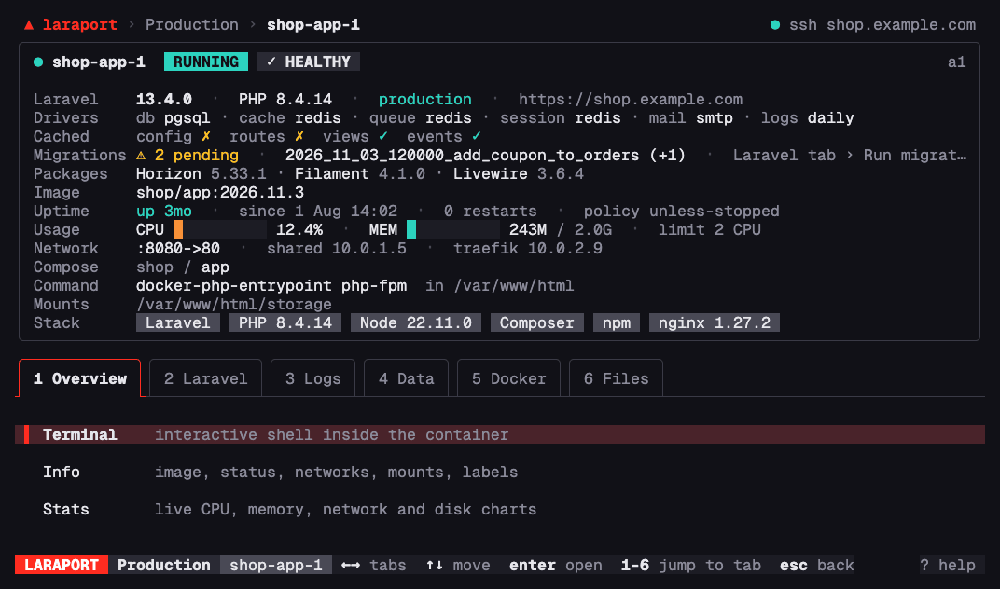

[](https://vshymanskyy.github.io/StandWithUkraine/)
[](https://stand-with-ukraine.pp.ua)
[](https://stand-with-ukraine.pp.ua)

[](https://github.com/alexbabintsev/laraport/releases/latest)


# <picture><source media="(prefers-color-scheme: dark)" srcset="docs/media/mark-dark.svg"></picture> laraport

**Your Laravel servers, a keypress away.** A terminal UI for Laravel apps running in Docker, locally or on any server you can SSH into: logs, Tinker, queues and Horizon, databases and files. Nothing to install on the server.



```bash
brew install alexbabintsev/tap/laraport
```

Documentation: **[laraport.app/docs](https://laraport.app/docs/)**

---

## What it does

### Every container, grouped the way you deploy

One list per server, with Dokploy projects, Swarm stacks and Compose projects as groups. Status, health, ports and live CPU and memory at a glance; old tasks from past deploys fold away. Favorites and display names survive redeploys, because they are bound to the service, not to the container name. Above the list, a panel shows the server itself: OS, load against its cores, memory, disks, Docker and Swarm, with warnings for a nearly full disk or a pending reboot (`p` folds it to one line).



### Logs you can search, filter and follow

Laravel, Docker and nginx logs. Search as you type, keep only warnings or errors, jump from error to error, follow a whole project in one stream. A 2 GB `laravel.log` opens as fast as a small one: lines are loaded in chunks as you scroll.


**Errors** groups the log's exceptions and warnings by kind: how often each happened, first and last time, where it was thrown, and the latest occurrence with its stack trace. A small Sentry from the log file alone: it reads the last 64 MB by default (`a` reads the whole file).


### Tinker in the running app

Write PHP on top, see the dumped result below, with the time and memory it took. The code runs in the booted app on the server through PsySH, like `artisan tinker`. On production it asks before the first run.



### Horizon, live, without opening a browser

Throughput, wait times, workload per queue and supervisors, refreshed every 3 seconds. Pending, completed and failed jobs with their payloads and exceptions. Retry, forget, clear, pause, terminate. Without Horizon, the Queues screen shows failed jobs and queue sizes.



### The app's database as a table you can edit

laraport reads the connection from the app's own config and opens that database: PostgreSQL, MySQL, MariaDB or SQLite, and the app's Redis and MongoDB. **Redis keys** finds keys by pattern (`laravel_cache:*`) with their type, TTL and size, shows a value by type and deletes a key after a confirmation. Sort, filter with `WHERE`, page, export to CSV or JSON. Every edit shows its SQL and runs only when you confirm; on production, editing has to be switched on first.




Prefer a desktop client? **Tunnel to PostgreSQL / MySQL / Redis** in the Data tab opens the app's server on `127.0.0.1` (port 15432 for 5432, 16379 for 6379) for TablePlus, DBeaver or RedisInsight, with the URL ready to copy. It is relayed through the app's container, so it reaches servers on a Swarm overlay network too, and nothing listens on the server.

**Restore a dump** (the database's Backup actions) streams a local `.sql`, `.sql.gz` or, for PostgreSQL, `.dump` into the database over stdin, with nothing copied to the server's disk. You type the database's name to confirm and see the exact `psql`, `pg_restore` or `mysql` command first; PostgreSQL restores in one transaction, so an error, a file cut short or a dropped connection leaves the database as it was. It has to be switched on first: *Allow restoring dumps* in Settings.

### Files, the Midnight Commander way

Browse the container, view files with syntax highlighting, edit them (`.env` with a diff before saving and a backup kept). Upload a file or a folder and it lands owned by the right user. Download anything as `.tar.gz`, streamed with no temp files on the server.


### After a deploy

The container's card warns about pending migrations, next to debug mode, maintenance and uncached config; the Laravel tab runs migrations, `optimize`, `optimize:clear`, a queue worker restart (`horizon:terminate` too where Horizon is installed) and maintenance mode on or off, each after a confirmation that shows the command.



### Every route, filtered as you type

Every route from `route:list --json` with its method, URI, name, controller and middleware; `/` filters as you type (`POST orders`, `auth:sanctum`), `v` hides the routes packages register.


### And more

- **Artisan, Composer and npm**: every command with its description and autocomplete; your own command groups in the config. `ctrl+t` runs the command in the terminal instead, for commands that ask questions (`make:filament-user`, Laravel Prompts).
- **Schedule and Environment**: the app's scheduled tasks with their next run (`t` runs one now through `schedule:test`, after a confirmation); the environment of Dokploy apps whose `.env` lives in the container's variables.
- **Shell**: an interactive terminal in any container (full PTY), also through a bastion.
- **Server resources**: images, volumes and networks with sizes and the containers using them, an update check against the registries, prune with the exact command in front of you.
- **Docker**: inspect, stats, top, diff, restart, start/stop, remove.
- **What happened last night**: `E` in the container list (or Events in a container's Docker tab) lists the containers that died, ran out of memory, were killed, restarted or turned unhealthy in the last 24 hours (`t` for 1 hour or 7 days, `b` for the problems only).
- **Compose projects**: the Docker tab of a Compose container pulls its image, recreates it with `up -d --no-deps`, or updates the whole project (pull, then `up -d`), in the directory and with the files the project was started from; `docker compose` or `docker-compose`, each confirmed with the command.
- **Swarm services** (Dokploy deploys to Swarm): every task of a service with the reason it failed (`no suitable node`, `non-zero exit (137)`, an unhealthy container), redeploy (`service update --force`), roll back and scale, each confirmed.
- **Journal**: `h` on the home screen lists every change laraport made, newest first: the command, SQL or path, the server and container, when, and how it ended (finished, failed, stopped). It stays on this computer (`~/.config/laraport/journal.jsonl`, mode 0600).
- **Every server at a glance**: `c` on the home screen checks all servers at once and shows under each one whether it answers, containers running and down, unhealthy ones, the disk, the load and warnings (or turn on *Check servers on start*).
- **Jump anywhere**: `ctrl+p` from any screen opens a container you used lately, another container of the server, or another server, connecting first when needed; a Swarm task or Compose container is found again after a redeploy. The home screen lists the recent ones.
- **Servers**: any number of SSH servers and the local Docker, jump hosts (`ssh -J`), a custom docker command such as `sudo -n docker` or `podman`, automatic reconnects.

---

## Install

**Homebrew** (macOS, Linux):

```bash
brew install alexbabintsev/tap/laraport
```

**Linux without Homebrew**, the latest release for your architecture:

```bash
version=$(curl -fsSLo /dev/null -w '%{url_effective}' https://github.com/alexbabintsev/laraport/releases/latest | sed 's|.*/v||')
arch=$(uname -m | sed 's/x86_64/amd64/; s/aarch64/arm64/')
curl -fsSL "https://github.com/alexbabintsev/laraport/releases/download/v$version/laraport_${version}_linux_$arch.tar.gz" | tar -xz laraport
sudo install laraport /usr/local/bin/
```

**Windows**: there is no native build. laraport should run in WSL2 with either install above, but it has not been tested there yet. `docker` has to work inside WSL (Docker Desktop with WSL integration, or Docker Engine in WSL), and SSH keys belong in the `~/.ssh` of WSL, not of Windows. [More on the site](https://laraport.app/docs/installation/#windows).

Your servers need Docker and SSH, nothing else. laraport authenticates with your `key:` from the config, then `ssh-agent`, then the standard keys in `~/.ssh`, and checks host keys against `~/.ssh/known_hosts`.

## Quick start

```bash
laraport
```

The local Docker is there without any config. Press `i` to import the hosts of your `~/.ssh/config`, or `a` to add an SSH server (`ctrl+t` tests the connection), `enter` to open it, `enter` on a container to open its screen. Every screen shows its keys at the bottom; `?` lists them all and `ctrl+k` opens the command palette with every action of the screen.

| Key | Action |
|---|---|
| `enter` / `esc` | Open / back |
| `↑↓` `jk`, `←→` `tab`, `1`–`6` | Move, switch tabs, jump to a tab |
| `/` | Filter or search |
| `l` / `t` / `f` | Logs / shell / files of the selected container |
| `?` / `ctrl+k` | Keys of the screen / command palette |

All keys: [laraport.app/docs/keys](https://laraport.app/docs/keys/).

## Configuration

`~/.config/laraport/config.yaml`, or a path as the first argument, or `LARAPORT_CONFIG`. Servers, settings and container settings can all be edited from the UI (`a` / `e` / `s`), so the file is optional:

```yaml
servers:
  - name: Production
    type: ssh
    host: your-server.com
    user: deploy
    key: ~/.ssh/id_ed25519
    jump_host: ops@bastion.example.com   # optional
    docker_cmd: sudo -n docker           # optional
    read_only: true                      # optional: refuse every change
    containers:
      - service: swarm/shop_web          # survives redeploys
        display_name: web
        favorite: true

  - name: Local
    type: local
```

Every option: [laraport.app/docs/configuration](https://laraport.app/docs/configuration/).

---

## License key

Without a license laraport works with local Docker and one SSH server: the first in your config. A license adds all your other servers. Get one at [laraport.app/pricing](https://laraport.app/pricing/), then press `l` on the home screen and paste the key, or run:

```bash
laraport license <key>
```

Keys are checked on your computer, so nothing is sent anywhere. Versions released while your updates last keep working for good.

## Security and privacy

- **Nothing on the server.** laraport runs the docker commands you would, over your SSH connection. No agent, no open ports, no telemetry. Once a day it asks GitHub for its own latest release, to say on the home screen when a newer one is out; nothing about you is sent, and *Check for new versions* in Settings (or `LARAPORT_NO_UPDATE_CHECK=1`) turns it off.
- **Secrets stay off the command line.** Database passwords and Tinker code travel over stdin, so `ps` on the server never shows them.
- **You see it before it runs.** Every change shows its exact command or SQL, with Cancel focused. Production is marked, Tinker asks first, and table editing and restoring dumps have to be switched on.
- **Read-only servers.** Mark a server *Read-only* (`read_only: true`) and laraport refuses everything that would change it: commands other than known reads (`route:list`, `composer show`…), restarts and deploys, edits of files and tables, SQL other than a single SELECT, Tinker, shells, uploads, restores and tunnels. Logs, tables, inspect and downloads work as usual. It guards laraport's own actions; for a guarantee at the database, connect with a read-only database user.
- **Local files are private.** `config.yaml`, SQL history, the journal and downloads are written with mode `0600`.

More: [laraport.app/docs/security](https://laraport.app/docs/security/). To report a vulnerability, see [SECURITY.md](SECURITY.md).

---

## License

laraport is commercial software: see [LICENSE](LICENSE). Local Docker and one SSH server are free.
